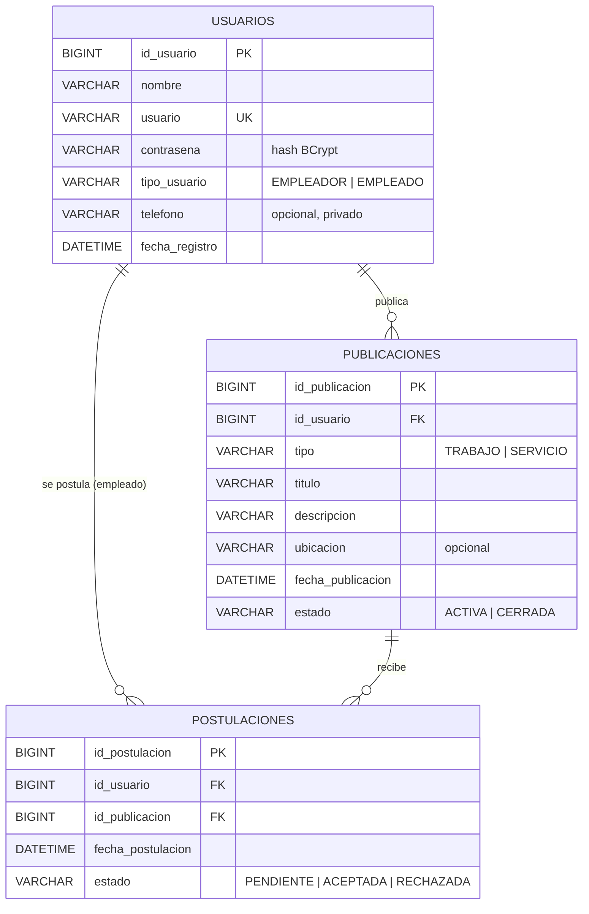

# Diseño de base de datos — Omni Solutions

Motor: **MySQL 8** · Base: `omni_solutions` · Juego de caracteres: `utf8mb4` / `utf8mb4_unicode_ci` · Motor de tablas: InnoDB.

Scripts:
- `database/01-crear-base-datos.sql`: crea la base, el usuario de aplicación y las tablas.
- `src/main/resources/schema.sql`: las mismas tablas (`CREATE TABLE IF NOT EXISTS`), ejecutado por la aplicación al iniciar.
- `database/02-datos-prueba.sql`: datos de ejemplo.

Hibernate trabaja con `ddl-auto=validate`: **no crea ni modifica tablas**, solo verifica al arrancar que las entidades
coincidan con el esquema.

## Diagrama entidad-relación

## Tablas

### USUARIOS

| Columna | Tipo | Nulo | Descripción |
|---|---|---|---|
| `id_usuario` | BIGINT AUTO_INCREMENT | No | Clave primaria |
| `nombre` | VARCHAR(100) | No | Nombre visible |
| `usuario` | VARCHAR(50) | No | Nombre de usuario, **único**, guardado en minúsculas |
| `contrasena` | VARCHAR(100) | No | Hash BCrypt (nunca texto plano) |
| `tipo_usuario` | VARCHAR(20) | No | `EMPLEADOR` o `EMPLEADO` (CHECK). No se modifica desde el perfil |
| `telefono` | VARCHAR(20) | Sí | Privado. Solo se entrega con una postulación aceptada |
| `fecha_registro` | DATETIME | No | Fecha automática de alta |

Restricciones: `pk_usuarios`, `uk_usuarios_usuario (usuario)`, `ck_usuarios_tipo`.

### PUBLICACIONES

| Columna | Tipo | Nulo | Descripción |
|---|---|---|---|
| `id_publicacion` | BIGINT AUTO_INCREMENT | No | Clave primaria |
| `id_usuario` | BIGINT | No | Autor (FK → USUARIOS) |
| `tipo` | VARCHAR(20) | No | `TRABAJO` (empleador) o `SERVICIO` (empleado) |
| `titulo` | VARCHAR(120) | No | 5 a 120 caracteres |
| `descripcion` | VARCHAR(2000) | No | 10 a 2000 caracteres |
| `ubicacion` | VARCHAR(120) | Sí | Opcional |
| `fecha_publicacion` | DATETIME | No | Fecha automática |
| `estado` | VARCHAR(20) | No | `ACTIVA` (por defecto) o `CERRADA` |

Restricciones: `pk_publicaciones`, `fk_publicaciones_usuario` (ON DELETE CASCADE), `ck_publicaciones_tipo`, `ck_publicaciones_estado`.

Índices:
- `idx_publicaciones_usuario (id_usuario)`: consulta de publicaciones propias.
- `idx_publicaciones_feed (estado, tipo, fecha_publicacion)`: feed de publicaciones activas filtradas por tipo y ordenadas por fecha.

### POSTULACIONES

| Columna | Tipo | Nulo | Descripción |
|---|---|---|---|
| `id_postulacion` | BIGINT AUTO_INCREMENT | No | Clave primaria |
| `id_usuario` | BIGINT | No | Empleado que se postula (FK → USUARIOS) |
| `id_publicacion` | BIGINT | No | Trabajo (FK → PUBLICACIONES) |
| `fecha_postulacion` | DATETIME | No | Fecha automática |
| `estado` | VARCHAR(20) | No | `PENDIENTE` (por defecto), `ACEPTADA` o `RECHAZADA` |

Restricciones: `pk_postulaciones`, `fk_postulaciones_usuario` y `fk_postulaciones_publicacion` (ON DELETE CASCADE),
**`uk_postulaciones_usuario_publicacion (id_usuario, id_publicacion)`** (impide postulaciones duplicadas incluso ante
solicitudes simultáneas), `ck_postulaciones_estado`.

Índices:
- `uk_postulaciones_usuario_publicacion`: además de la unicidad, sirve para las postulaciones realizadas por un empleado.
- `idx_postulaciones_publicacion (id_publicacion, estado)`: postulaciones recibidas por trabajo y conteos.

## Decisiones de diseño

- **VARCHAR + CHECK en lugar de ENUM** para tipos y estados: es portable, legible y evita incompatibilidades de validación
  de Hibernate con el tipo ENUM de MySQL. MySQL 8.0.16+ aplica los CHECK.
- **ON DELETE CASCADE**: eliminar una publicación elimina sus postulaciones (el servicio además lo hace explícitamente
  antes de borrar). No hay baja de usuarios en la beta, pero la cascada mantiene la integridad si se hace desde la base.
- **Reglas que no se expresan en SQL** (se validan en la capa de servicio): solo empleados se postulan, solo a trabajos
  activos, el tipo de publicación depende del rol, una postulación resuelta no cambia.
- No se agregaron tablas adicionales: el modelo cubre el MVP con las tres tablas pedidas.
