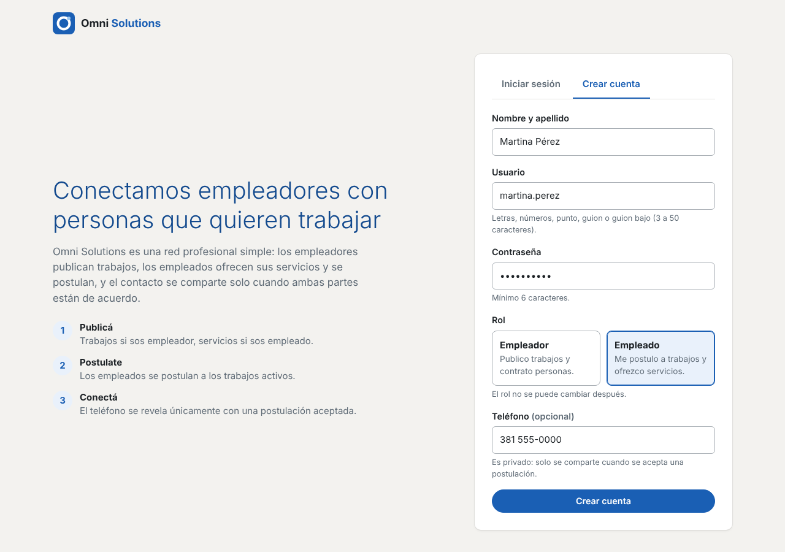
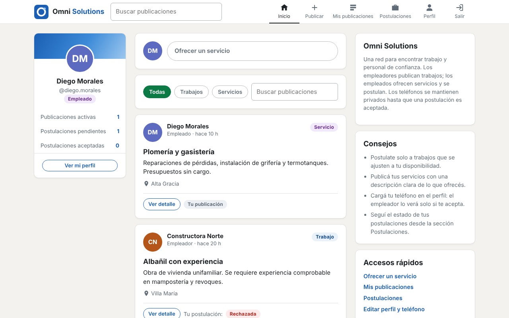
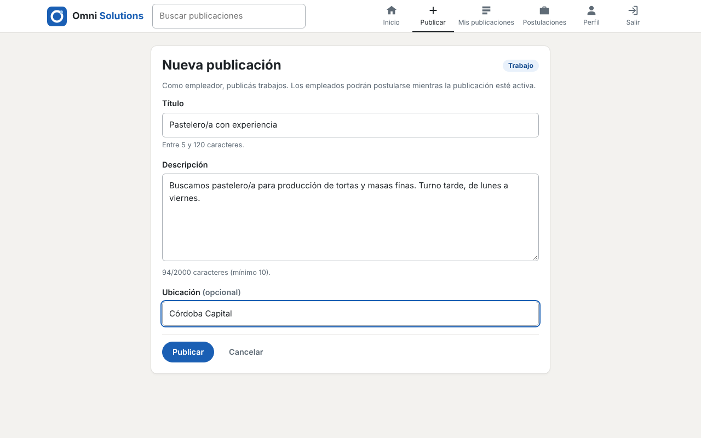
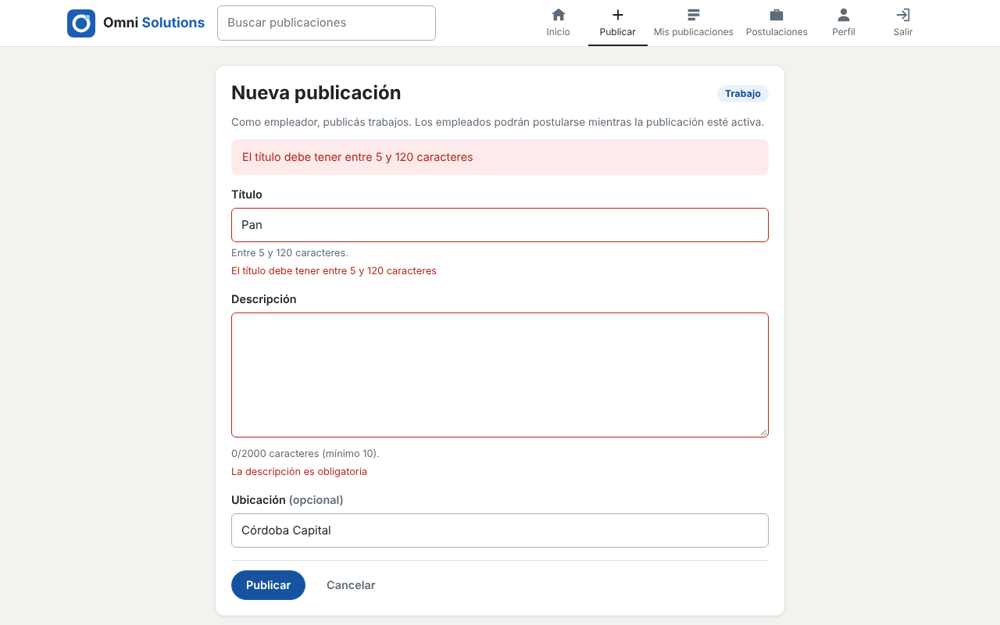
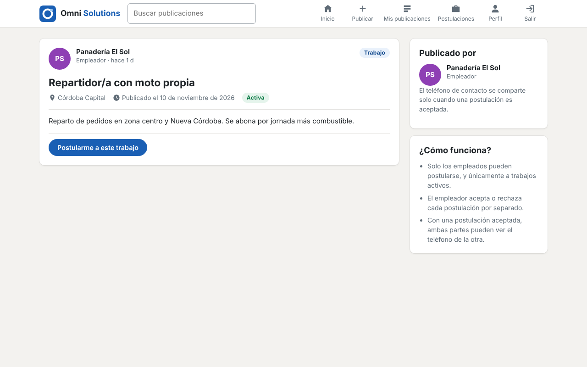
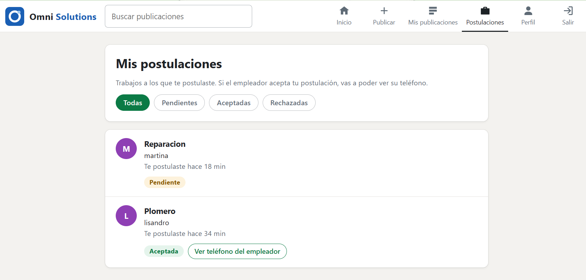
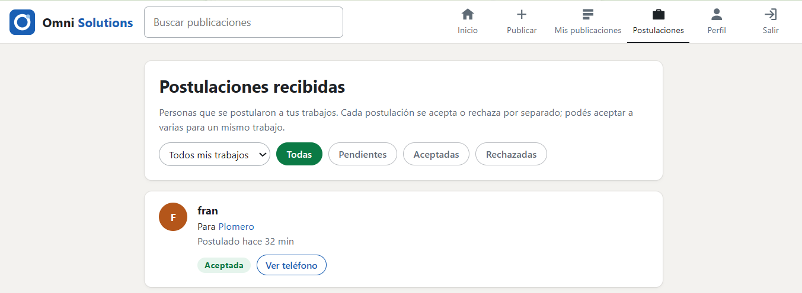
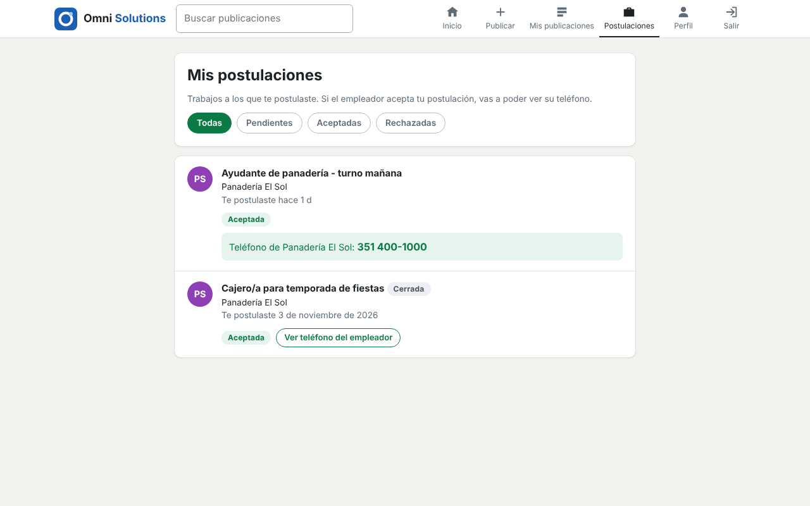
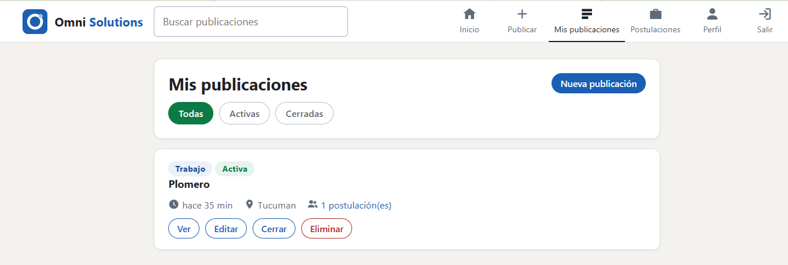
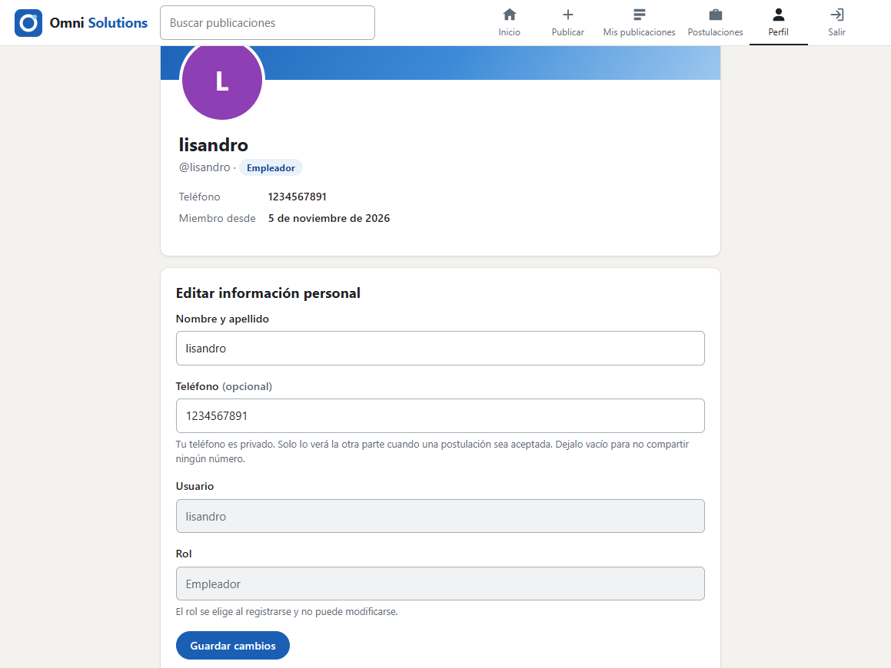

# Manual de usuario — Omni Solutions

Omni Solutions conecta a **empleadores** (publican trabajos y contratan) con **empleados** (se postulan a trabajos
y ofrecen sus servicios). El teléfono de cada persona es privado y solo se comparte cuando un empleador **acepta** una
postulación.

## Roles

| Acción | Empleador | Empleado |
|---|:---:|:---:|
| Publicar | Trabajos | Servicios |
| Postularse a trabajos | — | ✔ |
| Ver postulaciones | Recibidas en sus trabajos | Realizadas |
| Aceptar / rechazar postulaciones | ✔ (solo de sus trabajos) | — |
| Ver teléfono de la otra parte | De empleados aceptados | Del empleador que lo aceptó |

El rol se elige al crear la cuenta y **no puede cambiarse**.

## Flujo principal

El recorrido completo es el siguiente:

1. El usuario se registra.
2. El empleador publica un trabajo.
3. El empleado lo encuentra en el inicio y se postula.
4. El empleador acepta la postulación.
5. Los dos pueden ver el teléfono del otro para coordinar.

### 1. Crear una cuenta o iniciar sesión

En la pantalla de acceso (`index.html`) hay dos pestañas:

- **Crear cuenta**: completar nombre y apellido, usuario (letras, números, `.`, `-` o `_`), contraseña
  (mínimo 6 caracteres), **rol** y, si se quiere, teléfono. Al presionar **Crear cuenta** se inicia sesión
  automáticamente.
- **Iniciar sesión**: usuario y contraseña. El usuario no distingue entre mayúsculas y minúsculas.

### 2. Recorrer el inicio

La pantalla de inicio (`inicio.html`) se divide en tres columnas:

- **Izquierda**: tus datos (nombre, usuario y rol) y un resumen de tus publicaciones y postulaciones.
- **Centro**: las publicaciones **activas** de todos los usuarios. Se pueden filtrar por *Todas*, *Trabajos* o
  *Servicios* y buscar por palabra clave. Cada tarjeta tiene el botón **Ver detalle**. Los empleados ven además
  **Postularme** en los trabajos, o el estado de su postulación si ya se postularon.
- **Derecha**: información de la plataforma, consejos según tu rol y accesos rápidos.

La barra superior lleva a **Inicio**, **Publicar**, **Mis publicaciones**, **Postulaciones**, **Perfil** y **Salir**.

### 3. Publicar un trabajo (empleador) o un servicio (empleado)

En **Publicar**, el tipo de publicación se asigna según el rol: el empleador publica un **Trabajo** y el empleado,
un **Servicio**. Hay que completar el título, la descripción y, de forma opcional, la ubicación, y presionar
**Publicar**. La publicación queda **Activa** con la fecha del día.

**Validaciones:** si un dato es inválido, la publicación no se guarda y el error aparece debajo de cada campo.
Por ejemplo, un título de menos de 5 caracteres o una descripción vacía.

### 4. Postularse a un trabajo (empleado)

Desde el inicio, el empleado abre **Ver detalle** del trabajo que le interesa y presiona
**Postularme a este trabajo** (también puede postularse directamente desde la tarjeta del inicio). La postulación
queda **Pendiente**.

- Solo se puede postular una vez a cada trabajo.
- Los trabajos cerrados no aceptan nuevas postulaciones.
- Los servicios no reciben postulaciones.

En **Postulaciones**, el empleado ve todas sus postulaciones con su estado (*Pendiente*, *Aceptada* o
*Rechazada*) y puede filtrarlas por estado.

### 5. Aceptar o rechazar postulaciones (empleador)

En **Postulaciones**, el empleador ve quién se postuló a cada uno de sus trabajos. Puede filtrar por trabajo y
por estado, y en cada postulación pendiente tiene los botones **Aceptar** y **Rechazar** (la aplicación pide
confirmación).

- Cada postulación se gestiona por separado: aceptar una **no cambia** las demás, y se puede aceptar a varias
  personas para el mismo trabajo.
- Una postulación aceptada o rechazada **ya no puede cambiarse**.

### 6. Ver el teléfono de la otra parte

Cuando una postulación está **Aceptada**, aparece el botón **Ver teléfono** (para el empleador) o
**Ver teléfono del empleador** (para el empleado). Al presionarlo se muestra el número. Si la otra persona
no cargó un teléfono, se muestra un aviso.

Antes de la aceptación, el teléfono no aparece en ninguna parte de la aplicación.

## Otras pantallas

### Mis publicaciones

Lista todas tus publicaciones (activas y cerradas) y permite filtrarlas por estado. Cada una tiene estas opciones:

- **Ver**: abre el detalle.
- **Editar**: abre el formulario con los datos cargados.
- **Cerrar**: la publicación deja de aparecer en el inicio y no recibe nuevas postulaciones.
- **Eliminar**: borra la publicación y sus postulaciones. Pide confirmación.

En los trabajos, el enlace con la cantidad de postulaciones lleva a **Postulaciones** filtradas por ese trabajo.

### Detalle de una publicación

Muestra la publicación completa. Si sos el autor, tenés los botones **Editar**, **Cerrar publicación** y
**Eliminar**. Si es un trabajo, debajo aparece la lista de postulaciones recibidas, con las mismas acciones que en
**Postulaciones**.

### Perfil

Muestra tu nombre, usuario, rol, teléfono y fecha de registro. Se pueden modificar el **nombre** y el
**teléfono** (dejalo vacío para no compartir ningún número). El usuario y el rol no se pueden cambiar.

## Mensajes frecuentes

| Mensaje | Motivo |
|---|---|
| Usuario o contraseña incorrectos | Los datos de acceso no son válidos |
| El nombre de usuario ya está en uso | Hay que elegir otro usuario |
| El título debe tener entre 5 y 120 caracteres | El título es demasiado corto o demasiado largo |
| Ya te postulaste a este trabajo | Solo se permite una postulación por trabajo |
| El trabajo está cerrado y no acepta nuevas postulaciones | El empleador cerró la publicación |
| El teléfono solo está disponible cuando la postulación fue aceptada | La postulación todavía no fue aceptada |
| La sesión de seguridad expiró. Recargá la página… | Venció el token de seguridad: hay que recargar la página |
